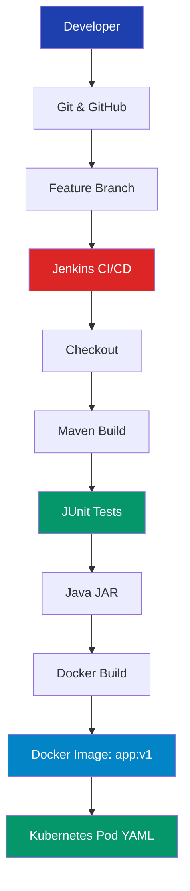

<div align="center">

# 🚀 DevOps Java CI/CD Automation

### End-to-End DevOps Project | SET 3

**Git & GitHub • Java • Maven • Jenkins • Docker • Kubernetes • AWS EC2**


**Project Status: Successfully Completed ✅**

</div>

---

## 📌 Project Overview

This project demonstrates an end-to-end DevOps workflow for a Java application hosted on an AWS EC2 Ubuntu server.

The project covers Git version control, Jenkins CI/CD automation, Maven builds, Docker containerization, and Kubernetes Pod YAML generation.

## 🏗️ DevOps Architecture



## 🔄 Jenkins CI/CD Pipeline


## 🛠️ Technology Stack

| Technology | Purpose |
|---|---|
| AWS EC2 | Cloud infrastructure |
| Ubuntu 24.04 | Operating system |
| Git & GitHub | Version control |
| Java 21 | Application development |
| Maven | Build automation |
| Jenkins | CI/CD automation |
| Docker | Containerization |
| Kubernetes / K3s | Kubernetes environment |
| kubectl | Pod YAML generation |

## 📁 Project Structure

```text
devops-java-cicd-automation/
├── src/
│   ├── main/java/com/devops/App.java
│   └── test/java/com/devops/
├── Dockerfile
├── pom.xml
├── pod.yaml
└── README.md
```

---

## 🟢 Q1 — Git & GitHub (15 Marks)

**Objective:** Clone a repository, create a feature branch, modify the Java application, commit changes, and push them to GitHub.

```bash
git clone https://github.com/shubhamdeshmukh1027/devops-java-cicd-automation.git
cd devops-java-cicd-automation

git checkout -b feature/set3-java-update

nano src/main/java/com/devops/App.java

git add .
git commit -m "Update Java application for SET 3"
git push -u origin feature/set3-java-update
```

**Result:** Java application changes successfully committed and pushed to GitHub.

---

## 🔵 Q2 — Jenkins CI/CD Pipeline (15 Marks)

**Objective:** Automate source checkout, Maven build, and unit testing.

### Jenkinsfile

```groovy
pipeline {
    agent any

    stages {
        stage('Checkout') {
            steps {
                git branch: 'feature/set3-java-update',
                    url: 'https://github.com/shubhamdeshmukh1027/devops-java-cicd-automation.git'
            }
        }

        stage('Build') {
            steps {
                sh 'mvn clean package -DskipTests'
            }
        }

        stage('Test') {
            steps {
                sh 'mvn test'
            }
        }
    }

    post {
        success {
            echo 'SET 3 PIPELINE SUCCESSFUL'
        }
        failure {
            echo 'SET 3 PIPELINE FAILED'
        }
    }
}
```

**Pipeline Result:**

| Stage | Status |
|---|---|
| Checkout | SUCCESS |
| Build | SUCCESS |
| Test | SUCCESS |

---

## 🐳 Q3 — Docker & Kubernetes (10 Marks)

**Objective:** Build Docker image `app:v1` and generate Kubernetes Pod YAML.

### Build Java Application

```bash
mvn clean package
```

### Dockerfile

```dockerfile
FROM eclipse-temurin:21-jre
WORKDIR /app
COPY target/devops-java-cicd-automation-1.0.0.jar app.jar
CMD ["java", "-jar", "app.jar"]
```

### Build and Verify Docker Image

```bash
sudo docker build -t app:v1 .
sudo docker images app:v1
sudo docker run --rm app:v1
```

### Generate Kubernetes Pod YAML

```bash
kubectl --kubeconfig=/tmp/set3-working-kubeconfig \
  --server=https://127.0.0.1:6443 \
  run app-pod \
  --image=app:v1 \
  --restart=Never \
  --dry-run=client \
  -o yaml > pod-generated.yaml
```

### Generated YAML

```yaml
apiVersion: v1
kind: Pod
metadata:
  labels:
    run: app-pod
  name: app-pod
spec:
  containers:
  - image: app:v1
    name: app-pod
    resources: {}
  dnsPolicy: ClusterFirst
  restartPolicy: Never
status: {}
```

**Result:** Docker image `app:v1` successfully built and Kubernetes Pod YAML successfully generated using client-side dry-run.

---

## 📊 Final Results

| Question | Task | Marks | Status |
|---|---|---:|---|
| Q1 | Git & GitHub | 15 | Completed |
| Q2 | Jenkins CI/CD | 15 | Completed |
| Q3 | Docker & Kubernetes | 10 | Completed |
| **Total** | **SET 3** | **40** | **Completed** |

---

## 👨‍🎓 Project Information

**Student:** Shubham Deshmukh  
**PRN:** 2125UDSM1027  
**Department:** SY-AIDS  
**University:** Sanjivani University

---

<div align="center">

### ⭐ DevOps Java CI/CD Automation

**GitHub | Jenkins | Docker | Kubernetes**

Developed for DevOps Final Practical Examination — SET 3.

</div>
